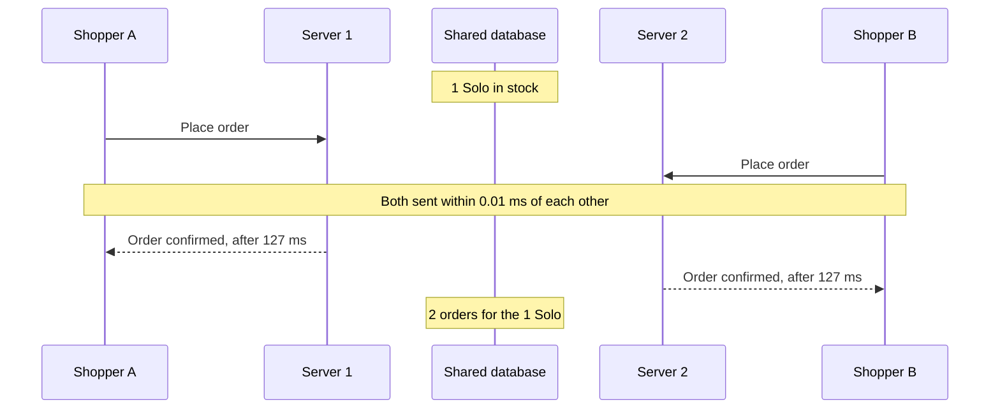

# One real test, step by step

These are real runs from this repo's published results, not a mock-up. Every number below comes from a saved run, and each part links to the file it came from.

## Part 1: The last item, sold twice

### The test

- The shop has **1** Solo in stock. Solo is a test product.
- The shop runs on **two servers** that share one database, the way shops add servers to handle more visitors.
- Shopper A has the Solo in a cart on server 1. Shopper B has it in a cart on server 2.
- Both click "Place order" at the same moment.

The right result: one order, and the other shopper is told it's out of stock.

### What happened

Run 13 of 30, Medusa 2.22.0, Nov 13, 2026 ([saved run](../results/last-unit-two-servers/2.22.0-2026-11-13/run-013.json.gz)).



| | Shopper A | Shopper B |
|---|---|---|
| Sent "Place order" | 0.005 ms after the start signal | 0.014 ms after the start signal |
| The store answered | Order confirmed | Order confirmed |
| Answer arrived | 127.1 ms after the start signal | 127.1 ms after the start signal |
| Order | `order_01M79QHSYGV1C5Y9E14T7G6FFY` | `order_01M79QHSYGQE2T9BXQ5GT9MC4J` |

1 ms is one thousandth of a second.

### What the database showed

Read from the database 2 seconds after the last answer:

| | Before | After |
|---|---|---|
| Solo in stock | 1 | 1 |
| Orders for the Solo | 0 | 2 |
| Solo units held for orders | 0 | 2 |
| The store's own count of held units | 0 | 1 |

Two orders for one Solo. The store's own count says 1 unit is held, which looks like one normal sale. Only the order rows, and the rows that hold a unit for each order, show what really happened. That's why Oversold reads those rows instead of trusting the count.

### What Oversold reported

The exact reasons saved in the run's file:

- `no_oversell`: **fail**. "SOLO live reservations 2 exceed stocked 1; SOLO orders need 2 units but 1 were stocked at the start of the race"
- `reserved_matches_reservations`: **fail**. "SOLO reserved_quantity 1 but live reservations sum to 2"
- `one_order_per_cart` and `no_orphaned_orders`: pass. Each cart became one order, and each order holds its unit.

This run was saved with the four checks of its time. Rechecked with the newer rule versions, it gets the same verdicts, and the newer `no_missing_orders` check passes.

### Why it happens

From Medusa's code and the issue reports ([#17032](https://github.com/medusajs/medusa/issues/17032), [#16569](https://github.com/medusajs/medusa/issues/16569)): before a checkout holds stock, the server takes a lock on the item, so only one checkout at a time can hold it. By default that lock lives in each server's own memory. With two servers there are two separate locks, so neither checkout waits for the other. Both read "1 in stock, 0 held", both hold the unit, and both write "1 held" to the count, so one write wipes out the other.

### The same test with a fix

Each row is 30 tries on Medusa 2.22.0:

| Setup | Last item sold twice | Saved runs |
|---|---|---|
| As released, default setup | 30 of 30 | [Nov 13, 2026](../results/last-unit-two-servers/2.22.0-2026-11-13/report.md) |
| With the shared Redis lock Medusa recommends for more than one server | 0 of 30 | [Oct 26, 2026](../results/last-unit-two-servers-redis-locking/2.22.0/report.md) |
| With community fix [#17420](https://github.com/medusajs/medusa/pull/17420), which locks the stock rows in the database | 0 of 30 | [Nov 12, 2026](../results/last-unit-two-servers/2.22.0-pr-17420/report.md) |

With the shared lock or the fix, one shopper gets the order and the other gets "Not enough stock available". In run 3 with the fix, shopper A's order was confirmed after 121 ms, and shopper B was turned away after 128 ms ([saved run](../results/last-unit-two-servers/2.22.0-pr-17420/run-003.json.gz)).

## Part 2: The cart that didn't add up

### The test

- The shop has **6** widgets in stock.
- One shopper's cart holds 4 single widgets and 2 two-packs. A two-pack is 2 widgets, so the cart needs **8**.
- One checkout. Nothing else happens at the same time.

The right result: refuse the order, since 8 is more than 6.

### What happened

Run 1 of 30, Medusa 2.22.0, Nov 13, 2026 ([saved run](../results/single-cart-over-demand/2.22.0-2026-11-13/run-001.json.gz)). The store answered "Order confirmed" after 140 ms.

| | Before | After |
|---|---|---|
| Widgets in stock | 6 | 6 |
| Widgets held for the order | 0 | 8 |
| The store's own count of held widgets | 0 | 8 |

Oversold reported `no_oversell`: **fail**. "WIDGET live reservations 8 exceed stocked 6; WIDGET orders need 8 units but 6 were stocked at the start of the race". Here the store's count agrees with its rows, so only comparing them with the stock shows the problem.

### Why it happens

From the issue reports ([#16502](https://github.com/medusajs/medusa/issues/16502), [#17436](https://github.com/medusajs/medusa/issues/17436)): the stock check looks at each line of the cart on its own. The 4 single widgets fit in 6, and the 4 widgets in the two-packs fit in 6, so both lines pass. Nothing adds them up to 8.

### The same test with a fix

| Setup | Cart of 8 accepted | Saved runs |
|---|---|---|
| As released | 30 of 30 | [Nov 13, 2026](../results/single-cart-over-demand/2.22.0-2026-11-13/report.md) |
| With community fix [#16961](https://github.com/medusajs/medusa/pull/16961), which adds up cart lines that use the same stock | 0 of 30, refused with "Not enough stock available" | [Nov 12, 2026](../results/single-cart-over-demand/2.22.0-pr-16961/report.md) |

## Neither fix covers both

| Medusa 2.22.0, 30 tries each | Last item sold twice | Cart of 8 accepted with 6 in stock |
|---|---|---|
| As released | [30 of 30](../results/last-unit-two-servers/2.22.0-2026-11-13/report.md) | [30 of 30](../results/single-cart-over-demand/2.22.0-2026-11-13/report.md) |
| With fix #17420 | [0 of 30](../results/last-unit-two-servers/2.22.0-pr-17420/report.md) | [30 of 30](../results/single-cart-over-demand/2.22.0-pr-17420/report.md) |
| With fix #16961 | [30 of 30](../results/last-unit-two-servers/2.22.0-pr-16961/report.md) | [0 of 30](../results/single-cart-over-demand/2.22.0-pr-16961/report.md) |

Both fixes change the same function in Medusa, `ensureInventoryLevels`, so they don't apply on top of each other.

## Check it yourself

Recheck every verdict from the saved runs, with Go and no Docker:

```sh
make build
./bin/oversold check --verify results/last-unit-two-servers/2.22.0-2026-11-13
./bin/oversold check --verify results/single-cart-over-demand/2.22.0-2026-11-13
```

`check --verify` recomputes every verdict and report from the saved runs and exits 0 only when they match. To see the two race calls of run 13:

```sh
gunzip -c results/last-unit-two-servers/2.22.0-2026-11-13/run-013.json.gz | jq -c '.operations[] | select(.phase == "race") | {action_id, server, status, outcome}'
```

## Credit

Both bugs come from Medusa's public issue tracker. Fix #16961 is by pqa-labs and fix #17420 is by haranishi, and both were closed without being merged. Oversold reproduced the bugs and ran the fixes through the same tests.
